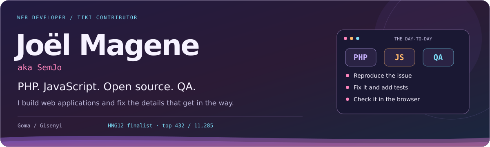
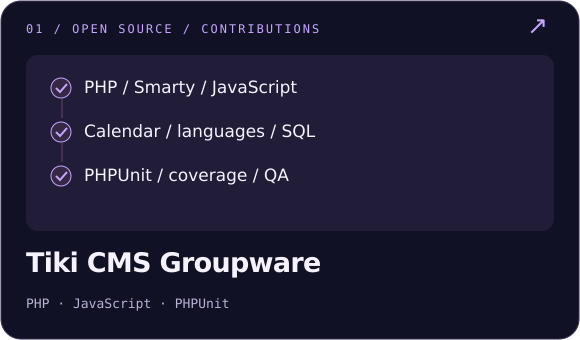
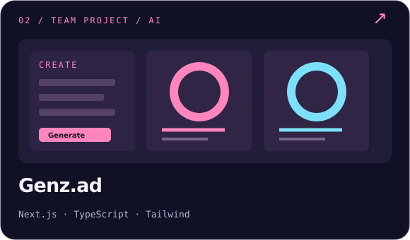
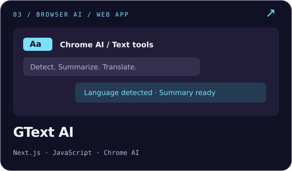
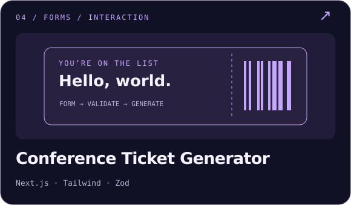

  <picture>
    <source media="(max-width: 600px)" srcset="./assets/hero-mobile.svg" />
    
  </picture>
  <picture>
    <source media="(max-width: 600px)" srcset="./assets/typing-mobile.svg" />
    
  </picture>

  
  
  
  

  <a href="https://dev.to/jomagene">DEV</a> ·
  <a href="https://medium.com/@semjomagene">Medium</a> ·
  <a href="https://x.com/jomagene98">X</a>

## About me

I’m **Joël (SemJo)**, a civil engineer turned web developer and **Tiki Wiki CMS Groupware contributor**. I work with **PHP, JavaScript, Smarty and SQL**, build interfaces with **React, Next.js and TypeScript**, and write tests for the bugs I fix.

## Development & QA

  <picture>
    <source media="(max-width: 600px)" srcset="./assets/skills-mobile.svg" />
    
  </picture>

**PHPUnit · Regression tests · Browser testing · GitLab CI · Backports**

## Selected work

<!-- Original illustrations. Each card links to the corresponding code. -->

  
  

  
  

Project notes

- **Genz.ad:** team contributions to forms and API integration; the card links to my fork.
- **GText AI:** a web app using Chrome AI APIs, rather than a browser extension.
- **Conference Ticket Generator:** multi-step forms with validation, saved state and ticket generation.
- **Tantor Learning:** an e-learning platform with role-based dashboards and Redux.

## Recent Tiki work

[Language preferences](https://gitlab.com/tikiwiki/tiki/-/merge_requests/11282) · [Calendar recurrence](https://gitlab.com/tikiwiki/tiki/-/merge_requests/11340) · [Changed-code coverage](https://gitlab.com/tikiwiki/tiki/-/merge_requests/11294)

What changed

- Kept admin language changes from overwriting the user’s regular language.
- Fixed occurrence edits so moving one event leaves the rest of the series unchanged.
- Added a report showing which changed PHP and JavaScript lines are covered by tests.
- Improved [Calendar loading](https://gitlab.com/tikiwiki/tiki/-/merge_requests/11098) and [SQL ranking queries](https://gitlab.com/tikiwiki/tiki/-/merge_requests/11102).

[All my Tiki merge requests →](https://gitlab.com/tikiwiki/tiki/-/merge_requests?scope=all&state=all&author_username=Jomagene)

## Contributions & activity

  <a href="https://gitlab.com/tikiwiki/tiki/-/merge_requests?scope=all&amp;state=merged&amp;author_username=Jomagene">
    <picture>
      <source media="(max-width: 600px)" srcset="./assets/tiki-impact-mobile.svg" />
      
    </picture>
  </a>

[Merge-request counts](https://gitlab.com/tikiwiki/tiki/-/merge_requests?scope=all&state=merged&author_username=Jomagene) · [SQL benchmark and test conditions](https://gitlab.com/tikiwiki/tiki/-/merge_requests/11133)

  <a href="https://gitlab.com/Jomagene">
    <picture>
      <source media="(max-width: 600px)" srcset="./assets/gitlab-activity-mobile.svg" />
      
    </picture>
  </a>

Updated daily. GitLab counts public contribution events, including pushes, merge requests and comments.

  

