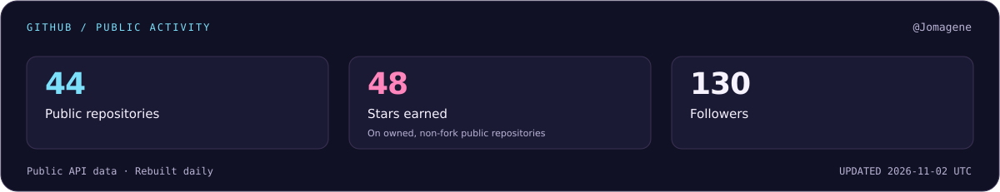

  <picture>
    <source media="(max-width: 600px)" srcset="./assets/hero-mobile.svg" />
    
  </picture>

  
  
  
  

  <a href="https://dev.to/jomagene">DEV</a> ·
  <a href="https://medium.com/@semjomagene">Medium</a> ·
  <a href="https://x.com/jomagene98">X</a>

## About me

I’m **Joël Magene**, also known as **SemJo**, based in **Goma / Gisenyi**. I started in civil engineering and now build web applications and contribute to **Tiki Wiki CMS Groupware**.

Much of my recent work is in **PHP, JavaScript and Smarty**: fixing Calendar behaviour, correcting how language preferences are saved, improving SQL queries and making test coverage easier to review. I also build frontend applications with **React, Next.js and TypeScript**.

I’m an **HNG12 finalist — top 432 of 11,285** — and I write about development on [DEV](https://dev.to/jomagene) and [Medium](https://medium.com/@semjomagene).

## Development & QA

  <picture>
    <source media="(max-width: 600px)" srcset="./assets/vendor/stack-mobile.svg" />
    
  </picture>

- **PHP & Tiki:** PHP, Smarty templates, SQL queries, multilingual behaviour, trackers and Calendar services.
- **JavaScript & UI:** JavaScript, TypeScript, React, Next.js, HTML, CSS, Tailwind, Sass, Vite and API integration.
- **QA & testing:** Bug reproduction, PHPUnit, regression tests, manual browser testing, timezone and recurrence checks, and coverage reporting.
- **Delivery:** Git, merge-request reviews, GitLab CI, conflict resolution and backports across supported Tiki versions.

For a bug fix, I reproduce the issue, add a regression test where it helps, and check the result in the browser. With Calendar work, that also means checking different timezones, all-day events and whether a change survives reopening the event or refreshing the page.

## Selected work

<!-- The cards are original illustrations, not screenshots. Each links to the actual code. -->

| | |
| :--- | :--- |
|  |  |
| **Tiki Wiki CMS Groupware** — fixes and improvements to Calendar, translation, preferences, queries and test tooling. | **Genz.ad · Team project** — frontend contributions to an AI advertising product, including forms and API integration. |
|  |  |
| **GText AI** — a web app for language detection, summarisation and translation using Chrome AI APIs. | **Conference Ticket Generator** — multi-step forms, input validation, saved form state and generated tickets. |

I’ve also worked on **Tantor Learning**, an e-learning platform with role-based dashboards and Redux.

## A few Tiki contributions

These are examples of the work behind the skills above. Each link includes the implementation and review discussion.

- **[Language preferences](https://gitlab.com/tikiwiki/tiki/-/merge_requests/11282):** Keep admin language changes from overwriting the user’s regular language, and restore temporary template overrides correctly.
- **[Calendar updates](https://gitlab.com/tikiwiki/tiki/-/merge_requests/11098):** Refresh events without reloading the page, reduce repeated data loading and improve date-range queries.
- **[Recurring events](https://gitlab.com/tikiwiki/tiki/-/merge_requests/11340):** Keep the series and its other events unchanged when moving one occurrence.
- **[SQL performance](https://gitlab.com/tikiwiki/tiki/-/merge_requests/11102):** Replace repeated correlated subqueries in user rankings with a calculation of the latest score per user.
- **[Changed-code coverage](https://gitlab.com/tikiwiki/tiki/-/merge_requests/11294):** Combine existing PHP and JavaScript coverage into a report showing which changed executable lines are tested.

[All my Tiki merge requests →](https://gitlab.com/tikiwiki/tiki/-/merge_requests?scope=all&state=all&author_username=Jomagene)

## Activity on GitHub & GitLab

  <a href="https://github.com/Jomagene?tab=overview">
    <picture>
      <source media="(max-width: 600px)" srcset="./assets/github-stats-mobile.svg" />
      
    </picture>
  </a>

  <a href="https://gitlab.com/Jomagene">
    <picture>
      <source media="(max-width: 600px)" srcset="./assets/gitlab-activity-mobile.svg" />
      
    </picture>
  </a>

The GitLab graph includes publicly visible pushes, merge requests and comments. These are contribution events, not individual commit counts. Both cards refresh daily; GitLab activity appears here separately from GitHub’s own contribution calendar.

  

